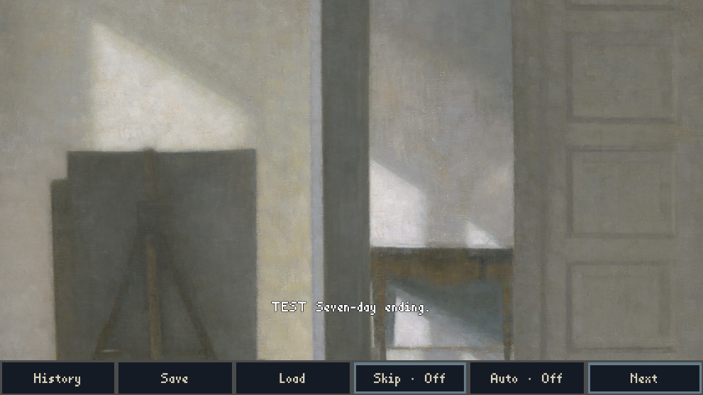

# Official Windows attempt: build correction passes; ending UIA wait fails

21 October 2026 Hong Kong. [Run39476916285](https://github.com/Siuuuers/dwm/actions/runs/39476916285), attempt1, job118815142853. Consumes the single conditional attempt in Director6297698097/6298163134 after C6298097130 and C6298344570 cleared both prerequisites. No retry.

Controller `4a90266752fb349883b90f65c929ff8e4cfd30b8` installed only the reviewed workflow blob `7218c4e9d5f70e0b04479360a5980d11c4a9d82e` using expected prior head `c0bb500fbbfdcc190c0a5a5a045f684d761cee88`. Product remains `c8358870d3ece92d5f8cc7ba65aefe34a746be5c`. Helper source13c34ff2 and driver8adc8c78 retain reviewed hashes. No runtime/source/save/history edits.

## Actual outcomes

| Boundary | Result |
|---|---|
| Baseline/import/raw/index/settings restoration | Passed |
| Export, actual package audit117, isolated headless smoke240 | Passed |
| Final generated UID allowance and package mappings | Passed |
| Native Capability | Passed, exit0, no forced cleanup |
| Native Create | Passed, exit0, no forced cleanup |
| Native Load | Failed: `UIA_UNAVAILABLE_OR_TIMEOUT: TEST Seven-day ending.` |
| Native TerminalLoad | Skipped/unexecuted |

Final preparation records34→38 generated inputs, all prior34 byte-identical, only the four permitted additions with valid UID/source provenance and consistent packaged-cache mappings. No source/sidecar PCK inclusion, zero tracked byte changes, only two allowed gitlink index removals. This qualifies the build-generated allowance on this attempt; it does not establish zero metadata influence.

## First failure and observed state

Load used a distinct process, restored the Day4 save, captured its slot2 witness, and advanced through Day7 closing. The harness failed at its original30-second ending-caption discovery gate; overall Load phase elapsed210.2152797s. The process was still alive and required forced cleanup (exit-1); do not count it as a clean exit or completed journey. Source slot1 and restored slot2 bytes are unchanged in the failure snapshots.

The post-failure screenshot visibly shows `TEST Seven-day ending.`. The diagnostic native probe at18:49:36.303Z reports a responsive visible engine window with23 UIA descendants but no ending-caption node; failure screenshot was captured at18:49:37.271Z. These are post-boundary observations, not proof of accessibility or visibility throughout the original wait. They show a discrepancy between rendered caption and captured accessibility exposure, not an established root cause or permission to change the selector/deadline.

Durable autosave is checkpoint17, lifecycle `ENDING`, playback `PRIMARY_PENDING`, empty playback receipts. Profile has no Gallery unlock/transaction. Ending completion, Gallery award, return to Title, fresh terminal Load and normal Load-process exit remain unproved. Reuse existing ending investigation and deadline reviews; do not infer a new save failure, rewrite prior failures, or reopen engine/cache tracing without a concrete scope.

## Original evidence and reproduction

Both original live artifacts are retained without repacking as24 numbered binary parts. Concatenate each archive's parts in numeric order; `archive-parts.json` specifies offsets, lengths, SHA256 and Git blob IDs. The original ZIP digests are:

| Artifact | ID | Bytes | SHA256 |
|---|---:|---:|---|
| preparation-original.zip |12290335909|8706715|`a8ebef5ad64a4871e7e157825fb48fe9574d0695c6434f8dd52f043f2f74b863`|
| delivery-original.zip |12291275153|101071775|`6215edef73970eb26429bd07d1394bded900a0ebe77462f2d565050fe8585327`|

Independent internal read-only verification checked safe unique ZIP inventories/CRC, all205+165 manifest payloads, nested package17 listed payloads plus validation.json, all2091 PCK payload MD5s, and2836 UID-cache records. Package SHA256 `1ee4e4cdc8b8c54be3cfeca1ceac8be7a273be7ebf3fc69120d8e226ffbd53a2`,99455011bytes. Phase receipts bind the same package/EXE/PCK; capture hashes and failure save witnesses verify. `verify_evidence.py` reproduces these checks after reconstructing the two ZIPs and writes `verification.json`. No Godot/PowerShell runs in offline verification. Connector-returned job log is separately preserved as `job.log.gz`; original logs remain inside artifacts. Existing engine/helper/action warnings remain disclosed.

## Next handoff

C reviews these actual package/native outcomes and the bounded success/failure classification before acceptance or harness integration. Director selects the next narrow ending accessibility/ordinary playable scope after that review; the one attempt is consumed. No automatic retry, longer wait, alternate selector, engine rebuild, product merge, release, or master/integration movement. Broader CI39476916336 is separate and not a delivery acceptance result.

Project coordination messages have standing user authorization; no further messaging approval gate applies.
